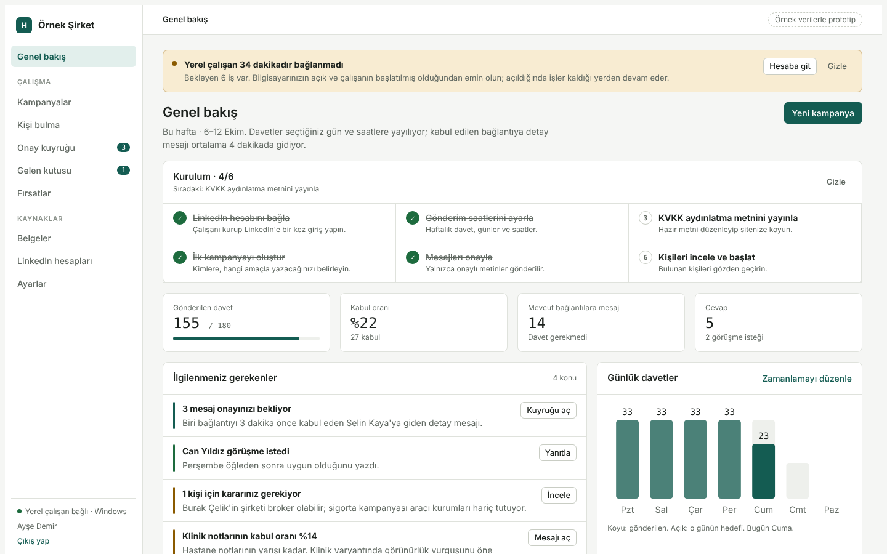
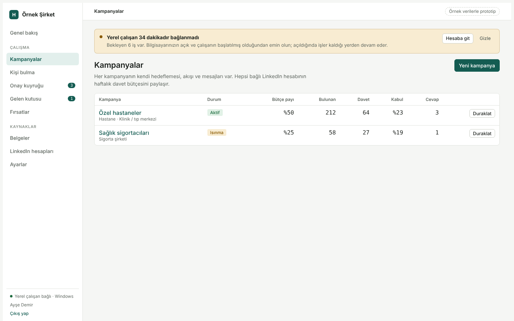
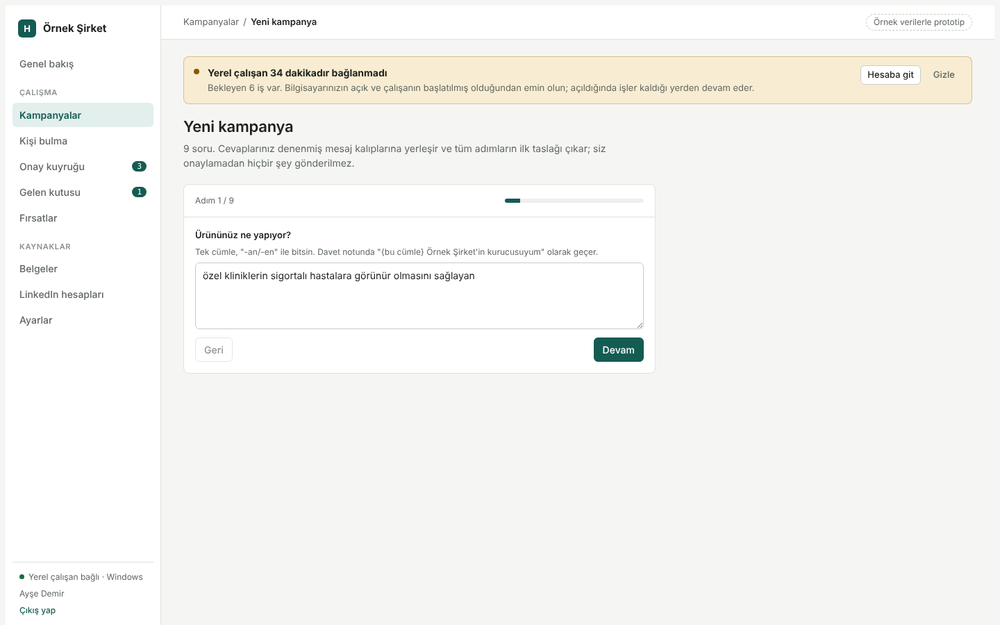
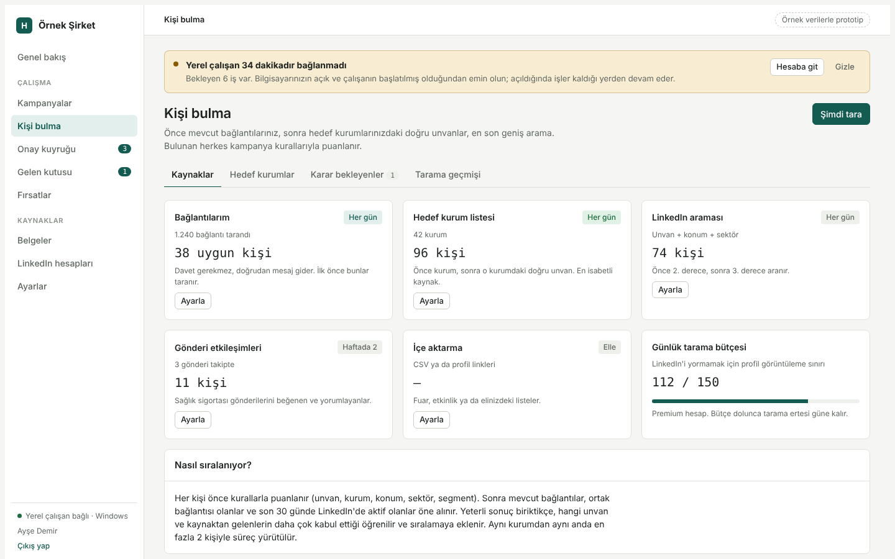
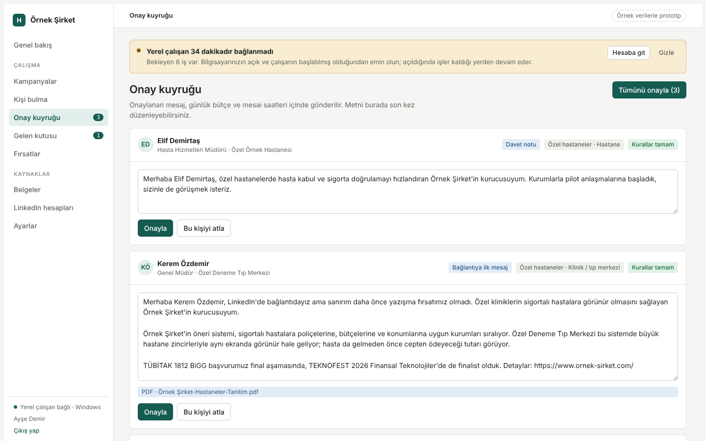
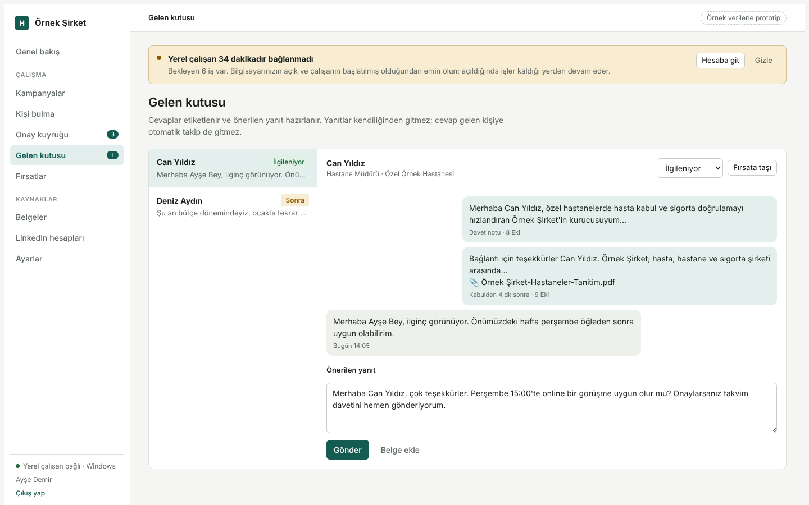
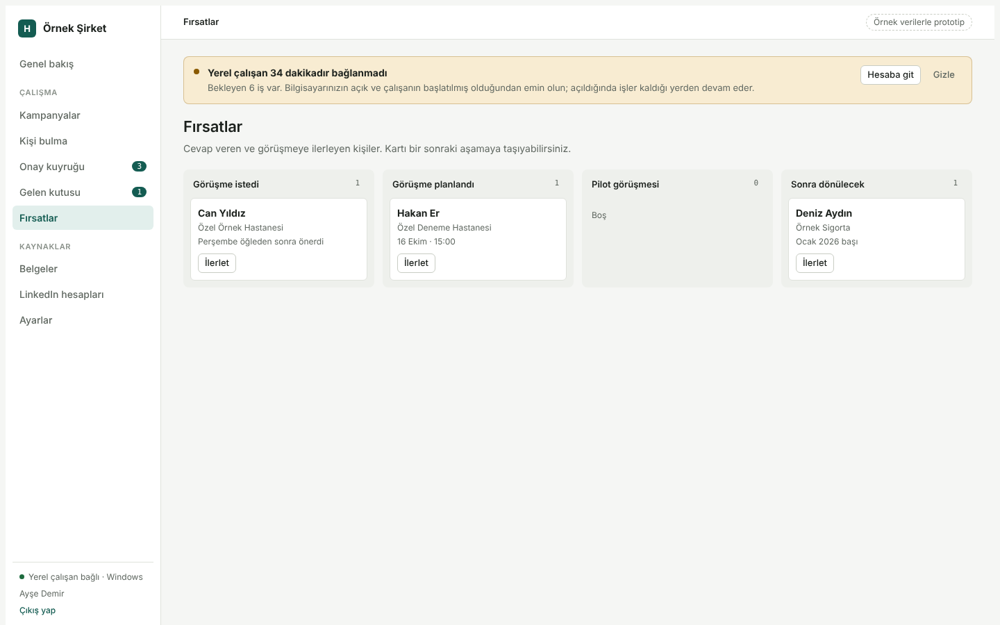
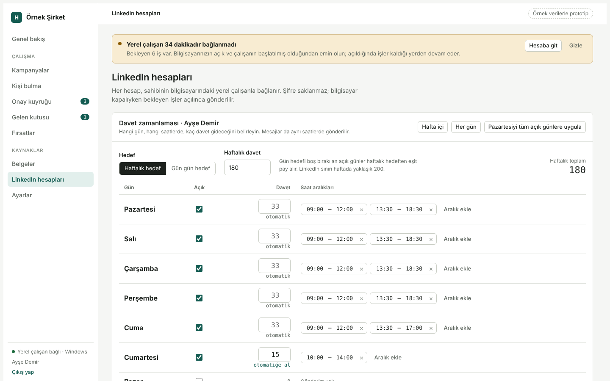

# LinkedIn Outreach Platformu

**Herhangi bir sektörde, doğru karar vericilere LinkedIn üzerinden güvenli ve kontrollü biçimde ulaşmak için kurulan, ücretsiz ve çok kullanıcılı bir iletişim platformudur.**

Panelden şirket ve kampanya tanımlarsınız; platform hedef kişileri bulur, her adayın **şu an çalıştığı kurumu ve görevini profilinden doğrular**, davetleri haftalık güvenli sınırın içinde gün ve saatlere yayar, bağlantı kabul edildiği anda onayladığınız mesajı gönderir, gelen cevapları etiketler ve sıcak fırsatları ayrı bir panoda toplar. LinkedIn işlemleri hesabın sahibinin kendi bilgisayarında, kendi Chrome oturumuyla yapılır; LinkedIn şifresi hiçbir yerde saklanmaz.

## Ekran görüntüleri

Aşağıdaki görüntüler örnek verilerle hazırlanmış arayüz prototipinden alınmıştır; gerçek kişi veya kurum içermez.

| | |
| --- | --- |
| **Genel bakış**: haftalık davet sayacı, kabul oranı, ilgilenmeniz gerekenler, günlük davet grafiği. |  |
| **Kampanyalar**: her hedef kitle için ayrı temsilci; durum, haftalık pay ve sonuçlar tek listede. |  |
| **Kampanya sihirbazı**: kimlere, hangi amaçla yazılacağı birkaç soruyla belirlenir; mesaj metinleri otomatik üretilir. |  |
| **Kişi bulma**: bağlantılarınız, hedef kurum listesi ve LinkedIn araması sırayla taranır; bulunan herkes kurallarla puanlanır. |  |
| **Onay kuyruğu**: kural denetimine takılan ya da sizin onay istediğiniz mesajlar gitmeden burada bekler. |  |
| **Gelen kutusu**: cevaplar etiketlenir ve buradan yanıtlanır. |  |
| **Fırsatlar**: sıcak görüşmeler aşama aşama izlenir. |  |
| **Hesaplar**: LinkedIn hesabının bağlantı durumu ve yerel çalışan anahtarı. |  |

## Kısaca nasıl kullanılır

1. Panelde bir kampanya kurarsınız: kime, hangi amaçla, hangi mesajla yazılacağını sihirbaz birkaç soruyla toplar.
2. Kendi bilgisayarınıza yerel çalışanı kurar ve LinkedIn'e bir kez giriş yaparsınız.
3. Platform kişileri bulur, doğrular ve davetleri haftalık sınırın içinde yayar. Mesajlar yalnızca onayladığınız metinlerle gider.
4. Cevaplar gelen kutusunda, sıcak görüşmeler fırsatlar panosunda toplanır.

## Sektörden bağımsız tasarım

Platformda hiçbir sektöre ait sabit kural yoktur; her şey kampanya ayarı olarak tanımlanır. Aynı yapı sağlık, finans, yazılım, üretim, eğitim, gayrimenkul, danışmanlık gibi herhangi bir alanda çalışır:

- **Hedef unvanlar**: aranacak ve puan verilecek görevler (ör. "Satın Alma Müdürü", "Genel Müdür", "Pazarlama Direktörü").
- **Hedef kurumlar**: elle girilen ya da listeden alınan kurum adları; eşleşen kuruma ek puan verilir.
- **Sektör ve kurum anahtar kelimeleri**: kurumun doğru sektörde olduğunu doğrulayan ifadeler.
- **Hariç tutma**: istenmeyen sektör, kurum, unvan ve ifadeler; bunlar kesin eleme sebebidir.
- **Konum**: hedef şehir ve ülkeler.
- **İşlev anahtar kelimeleri**: görev tanımında aranan konular; görev başlığı belirsizse görev açıklaması da değerlendirilir.
- **Mesaj akışı**: ziyaret, davet, kabul sonrası mesaj ve takipler; şablonlar, zamanlama ve kurallar kampanya bazındadır.

Yeni bir sektöre geçmek için kod değişmez; yalnızca yeni bir kampanya kurulur.

## Kişi bulma ve doğrulama

Arama sonucundaki kart yalnızca başlangıçtır; karar kartın üst satırına bakılarak verilmez.

1. **Kartı oku**: ad, başlık, konum, bağlantı derecesi ve kartın "Şu an" satırındaki güncel görev ve kurum ayrıştırılır.
2. **Katı puanla**: unvan, kurum, sektör, konum ve işlev uyumu puanlanır. Hariç tutulanlar, yanlış sektörler (ör. aynı unvanı taşıyan ama farklı alandaki kişiler) ve ilgisiz işlevler elenir.
3. **Belirsizi doğrula**: kartta unvan ya da kurum anlaşılamıyorsa kişi atılmaz, "doğrulanacak" havuzuna alınır. Çalışan profili açar, **Deneyim bölümündeki güncel pozisyonların hepsini** okur (görev, kurum, süre, görev tanımı).
4. **Güncel pozisyonu puanla**: her güncel pozisyon ayrı değerlendirilir, en uygunu kişinin kararı olur. Geçmiş görevler dikkate alınmaz. Görev tanımı hedef konularla ilgiliyse ek puan verilir.
5. **Karar**: uygun olanlar kuyruğa girer, belirsizler kampanyanın "belirsizleri nasıl ele al" ayarına göre sorulur ya da elenir, uymayanlar gerekçesiyle elenir. Her karar gerekçesiyle saklanır ve geri alınabilir.

Elenenler, kurallar değiştiğinde tek tuşla yeniden değerlendirilebilir; elle atlananlara dokunulmaz.

## Ne işe yarar

| Alan | Yapabildikleriniz |
| --- | --- |
| **Şirketler** | Birden fazla şirket ekleyin; her şirkete ayrı temsilci (kampanya) atayın. Aynı anda en fazla **5 aktif temsilci** çalışır. |
| **Kampanyalar** | Sihirbazla veya hazır şablonla kurun. Akış (ziyaret → davet → mesaj → takip), hedefleme, gönderim saatleri, otomatik geri çekme, A/B, öğrenme ve webhook ayarları kampanya bazında açılıp kapanır. |
| **Kişi bulma** | Arama kriterlerinden aday toplar; puanlar; profilden doğrular; belirsiz adaylar için "sor / ele / güçlü olanı kabul et" seçeneği sunar. |
| **Kurumlar** | Hedef kurum listesi oluşturulur; kurumdaki kişiler bu listeye göre aranır ve puanlanır. |
| **Onay kuyruğu** | Kural denetimine takılan veya sizin onay istediğiniz mesajlar gitmeden önce burada bekler. |
| **Gelen kutusu** | Cevaplar etiketlenir (ilgili, ertele, ilgisiz, toplantı…), filtrelenir ve buradan yanıtlanır. |
| **Fırsatlar** | Sıcak görüşmeler süreç panosunda aşama aşama izlenir. |
| **Analitik** | Davet, kabul, cevap ve toplantı oranları; günlük grafikler; kampanya ve şablon karşılaştırması. |
| **Hesaplar** | LinkedIn hesabının bağlantı durumu, haftalık davet sayacı, yerel çalışan anahtarı. |
| **Belgeler** | Mesajlara eklenecek PDF vb. dosyalar. |

Kapsam dışı (bilerek): içerik/paylaşım üretimi, ücretli e-posta bildirimi (bunun yerine imzalı webhook ile Zapier/Make bağlanır), LinkedIn'den güvenilir okunamayan niyet sinyalleri.

## Mimari

```
Tarayıcı ──► Panel (Next.js, Vercel) ──► Supabase PostgreSQL
                    ▲
                    │ HTTPS + bağlantı anahtarı (hfo_…)
                    │
        Yerel çalışan (Playwright + Chrome)  ◄── kullanıcının kendi bilgisayarı, kendi LinkedIn oturumu
```

| Klasör | Ne |
| --- | --- |
| `apps/web` | Panel (Next.js 15, React 19, Supabase Auth, Prisma). Planlayıcı ve yerel çalışanın API'si de burada. |
| `apps/runner` | Yerel çalışan. Panelden sıradaki işi ister, Chrome'da yapar, sonucu bildirir. Windows ve Mac. |
| `packages/core` | Yapay zekâsız motor: akış, zamanlama, bütçeler, katı puanlama, profil doğrulama, mesaj kuralları, cevap etiketleme, öğrenme. Vitest ile test edilir. |
| `packages/db` | Prisma şeması ve elle yazılmış SQL göçleri. |
| `docs` | KVKK aydınlatma metni, arayüz planı, tasarım notları. |

### Nasıl çalışır

1. Çalışan dakikada bir "sıradaki iş ne?" diye sorar. Panel o an planlama yapar (zamanlanmış görev gerekmez) ve zamanı gelmiş en öncelikli işi verir.
2. Planlama; haftalık 180 davet sınırı, günlük bütçe, kampanya payları, gönderim pencereleri, tatiller, kurum başına sınır ve akış adımlarına göre yapılır. Son kontrol işi verirken tekrar yapılır. Profil doğrulama ziyaretleri de aynı bütçe içinde, öncelik sırasıyla (ortak bağlantısı çok olan ve hedef kurumdan gelenler önce) yapılır.
3. Çalışan işi Chrome'da insan gibi aralıklarla yapar. İki gönderim arasında en az 45 sn bekler; LinkedIn uyarısında gönderim 24 saat duraklar.
4. Kabul edilen bağlantılar düzenli taranır; kabul edene detay mesajı kısa süre içinde (gece ise sabah) gider.
5. Her mesaj gönderilmeden önce kural denetiminden geçer: yasak ifade, hariç kurum, karakter sınırı, zorunlu link. Geçmeyen mesaj onaya düşer.

## Güvenlik ve KVKK

- LinkedIn şifresi istenmez ve saklanmaz; oturum yalnızca kullanıcının bilgisayarındaki ayrı Chrome profilinde durur.
- Çalışan veritabanına bağlanmaz; yalnızca kendi anahtarıyla sınırlı uçlara erişir (anahtarın yalnızca özeti saklanır).
- Tüm tablolarda Row Level Security açıktır. Panele yalnızca `ALLOWED_EMAILS` listesindekiler ve davet edilenler girer.
- Webhook'lar HMAC-SHA256 ile imzalanır (`X-HFO-Signature`), yalnızca https kabul eder, iç ağ adreslerine karşı korumalıdır.
- Cevap vermeyenlerin verisi ayarlanan süre sonunda silinir; "bir daha yazma" ve silme taleplerinde yalnızca profil linkinin özeti tutulur.
- Kişi verisi hiçbir yapay zekâ servisine gönderilmez. `.env` ve tarayıcı profilleri repoya girmez.
- `docs/kvkk-aydinlatma.md` yayınlanmadan önce köşeli parantezli alanlar doldurulmalı ve hukuki incelemeden geçmelidir.

## Maliyet

Hiçbir ücretli servis gerekmez: Vercel Hobby, Supabase ücretsiz katman, GitHub Actions.

## Kurulum

Panel ve çalışan kurulumu adım adım **[KURULUM.md](KURULUM.md)** içindedir. Çalışanı ilk kez kullanırken `pnpm runner --kontrol` ile yalnızca kendi profilinizi okutup seçicileri deneyin, sonra normal çalıştırın.

## Geliştirme

```
pnpm install
pnpm --filter @hfo/core test        # motor testleri
pnpm --filter @hfo/web exec tsc --noEmit
pnpm dev                            # panel (POSTGRES_* ve Supabase değişkenleri gerekir)
```

CI her gönderimde testleri, tip kontrolünü, derlemeyi ve göçlerin şemayla birebir uyduğunu denetler. Vercel derlemesi `prisma migrate deploy` çalıştırıp ardından `next build` yapar.

## Mobil ve ekran uyumu

Panel telefondan geniş ekrana kadar çalışır: ≤900 px'te sol menü çekmeceye dönüşür (üstte menü düğmesi), tablolar yatay kayar, kampanya alt menüsü kaydırılabilir şerit olur; 380 px'e kadar ve kısa (yatay telefon) ekranlar için ayrı kurallar vardır.
